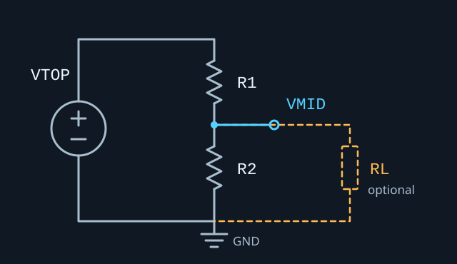

# Voltage Divider — Schematic Export (Markdown)

miniPCB · Circuit boards for electronics education

This hand-authored reference describes the calculator's ideal DC circuit; it is
not an EAGLE board export. The downloadable LTspice file contains the default
values below. Calculator edits do not modify these reference files.

The calculation choices appear above the live circuit SVG. The SVG updates VTOP,
VMID, the equivalent arm resistances, and the open/finite RL value as you edit.
Voltage readouts are part of the circuit drawing: VTOP and source tolerance sit
beside the source, and VMID sits at the end of a blue output wire extending just
past the RL branch. A separate, spaced VMID readout lists **Nominal**, **Min** and
**Max** voltages for both normal calculations and pair previews. Its minimum and
maximum use the same entered tolerance limits as the analysis results; pair
previews also show their target error. Invalid circuit data clears all three
values. The nominal voltage remains editable, and the readouts retain their
solve-role colors and appear in the standalone SVG download.
Each physical RTOP/RBOT resistor is annotated with its resistance, tolerance,
footprint size, power rating, Pstress, Vstress, and Istress. The drawing contains
one symbol per physical RTOP/RBOT resistor in the work form, wired as a series
chain or a parallel bank. A finite RL adds its load symbol; an open RL has no
resistor symbol. Each drawn part shows its value, tolerance and footprint;
manual footprints read **Not set**, since package size cannot be inferred from
power. Equivalent arm labels stay available for editing the total resistance.
VTOP, RL and every physical resistor have rounded, borderless information boxes
matching the VMID readout. Parallel-bank boxes keep the resistor symbols and
connections visible. Each physical part's detailed values, ratings, stresses
and part numbers also share one padded box, which expands for alternate MPNs.
The detail boxes retain both valid family MPNs with their independent ratings.
Ratings are not combined. Stress
values use the nominal operating point and include each part's working-voltage
limit when entered. Invalid circuit data clears the live values and stresses.

The component legend uses **yellow** for missing/invalid inputs or an unspecified
footprint, **green** for defined information, and **red** for the active solve
target. Given/Missing/Solve labels and a **Solving for** heading identify the
roles without relying on color. The selected calculation, form inputs and result
use the same cues; a solved value stays red to identify its role. A blank optional
RL is a defined open circuit. Multi-part arms highlight all resistors being
scaled. Pair previews highlight the candidate RTOP/RBOT in red; the applied
circuit remains labeled as given information when no pair preview is shown.
Stress colors continue to describe rating limits independently of input roles.

Click an underlined SVG value, or focus it and press Enter/Space, to edit the
circuit. VTOP opens voltage and source tolerance; RL opens resistance and load
tolerance (blank resistance means open circuit). Each physical resistor opens
its resistance and dropdowns for family, footprint, TCR (ppm/°C), tolerance and
reliability level. M55342 offers the catalog reliability codes; TNPW displays
**Not applicable**. Footprint, TCR and tolerance choices follow the selected
family's supported combinations. A live part-number preview shows the result.

Power is read-only in the SVG editor and follows the selected catalog part's
footprint, operating mode and ambient derating. Catalog working-voltage limits
also update automatically. Saving applies the validated part number, tolerance,
power and voltage limits to the circuit and BOM. Unsupported exact values and
parts exceeding nominal power/voltage limits cannot be applied. Existing catalog
parts reopen with their reliability, TCR, tolerance, footprint and conditions.

For an unassigned resistor, **Manual · keep current limits** preserves its current
power rating and offers a tolerance dropdown and optional working-voltage input.
Choose a family to enable catalog footprint, TCR and reliability choices. Manual
mode permits custom values and clears a prior catalog assignment when explicitly
selected. Source/load tolerances retain numeric entry. Saving updates the existing
forms and recalculates VMID and stress using forward analysis. Cancel or Escape
leaves the circuit unchanged.

Click VMID to enter a target and choose whether VTOP, RTOP, RBOT or RL should be
solved. For a multi-resistor arm, clicking its equivalent value or connection
opens an editor that scales all part resistances together for the requested
equivalent and series/parallel connection, preserving independent ratings and
tolerances. Individual SVG rows edit just that physical resistor. Invalid edits
remain in the editor with an error and leave the applied circuit unchanged.

The SVG reflows for smaller screens and stays on the calculator page.
**Download SVG** captures the current annotations in a standalone SVG. The image
below and the LTspice/Markdown downloads remain the default circuit references;
the calculator keeps its live SVG, editor, styling, and logic in the one HTML
file. Downloads are static annotated images without calculator editing controls.

In the resistor-pair visualization, selecting a point or table row previews that
pair in the top SVG, including VMID bounds, error, power, current, Rth and worst
stress. The per-part fields show the selected MPN's nominal stress. Matching
TNPW or M55342/D55342 alternatives appear alongside it with their own power and
voltage limits. Preview alternatives must also satisfy the pair search criteria;
other calculator views check alternatives at the nominal operating point.
Selecting a candidate preserves the applied circuit inputs and BOM. The heading
identifies the preview, and Download SVG captures it. Leaving the visualization
or selecting an empty region restores the current circuit display.
The same value editors work on a selected pair preview. Their **Apply pair and
save** action explicitly applies that pair before saving edits to the circuit;
canceling preserves both the preview and the applied circuit. Catalog search
results retain their original validated specifications.



[Calculator](../calculators/voltage_divider.html) ·
[LTspice schematic](../ltspice/voltage_divider.asc)

## Circuit data

VTOP is the source voltage at the top of RTOP. VMID is the midpoint voltage
between RTOP and RBOT. Both voltages are measured relative to ground.

| Reference | Description | Default value | Positive node | Negative node |
| --- | --- | --- | --- | --- |
| V1 | Ideal DC source | 12 V | VTOP | 0 (ground) |
| R1 | Upper divider resistor | 10 kΩ | VTOP | VMID |
| R2 | Lower divider resistor | 10 kΩ | VMID | 0 (ground) |
| RL | Optional output load | Open; 100 kΩ when enabled in LTspice | VMID | 0 (ground) |

R1 and R2 default to 1/4 W in the calculator. Power ratings and optional maximum
working voltages are analysis inputs; the ideal LTspice resistors do not model
rating limits or failure.

## Netlist

```spice
* Default unloaded divider
V1 VTOP 0 DC 12
R1 VTOP VMID 10k
R2 VMID 0 10k
* Optional load: uncomment to enable
* RL VMID 0 100k
.op
.end
```

The `.asc` reference instead uses `LOAD_ON=0` and an RL resistance of 1e18 Ω to
approximate an open circuit. Set `LOAD_ON=1` to use the `RLOAD` parameter.

## Analysis

- `Rb = R2 || RL`, or `R2` when the load is open.
- `VMID = VTOP × Rb / (R1 + Rb)`.
- `I1 = (VTOP − VMID) / R1`; `I2 = VMID / R2`; `IL = VMID / RL` (zero for open load).
- Each resistor dissipates `P = I² × R`.
- Total dissipation is `P1 + P2 + PL = VTOP × I1`.
- The unloaded Thevenin resistance is `Rth = R1 || R2`.

At the defaults, VMID is 6 V, I1 and I2 are 0.6 mA, and R1 and R2 each dissipate
3.6 mW. Total power is 7.2 mW and Rth is 5 kΩ.

## Solve modes

RTOP is R1 and RBOT is R2. The calculator can solve for VMID, VTOP, RTOP, RBOT,
or RL while the remaining nominal quantities are held at their entered values.
Choose a calculation button at the top of the page. The sixth button,
**Find real resistor pairs**, searches actual catalog parts for a target VMID.
Each circuit-analysis view names the goal, explains its inputs, and shows a
matching equation and Calculate action. Only known quantities appear as primary
inputs; the calculated quantity appears in the result banner. Switching views
preserves circuit data.

The result area uses **Overview**, **Tolerances**, **Stress**,
**Ratings**, **Parts**, **Parts (2)**, **Resistor pairs**, and **Method** tabs to show
one focused panel at a time.
The solved value stays visible above the tabs; all results continue updating as
you edit. Switching result tabs preserves circuit data and selected parts.
Pair searches open **Resistor pairs**; circuit calculation choices open
**Overview**. The Calculate action opens the relevant result view, and Reset
restores **Overview**. Use Left/Right Arrow, Home, or End to navigate the tabs
with a keyboard. Printing includes all result panels.

Output load and tolerance/rating settings are collapsible. Pair searches have
their own target and tolerance form. An invalid setting automatically opens its
containing sections so it can be corrected. The page styling and circuit-analysis
logic remain in the one HTML file; shared part catalogs and their numbering
engine are loaded separately.

- VMID uses the loaded divider equation above.
- `VTOP = VMID × (1 + RTOP / Rb)`.
- With `g = VMID / VTOP`, `RTOP = Rb × (1 − g) / g`.
- To solve a lower resistance, first calculate `Rb = RTOP × g / (1 − g)`.
- Unloaded: `RBOT = Rb`. Loaded: `RBOT = Rb / (1 − Rb / RL)`.
- To solve the load: `RL = Rb / (1 − Rb / RBOT)`.

Resistance solutions require the same sign for VTOP and VMID with
`0 < abs(VMID) < abs(VTOP)`. A passive load cannot increase the unloaded output
magnitude. The load solution is open circuit when the target equals the unloaded
output. Zero, negative, infinite, and otherwise infeasible resistance solutions
are rejected. Solved resistances are exact design values, not rounded to a
preferred component series.

## Multiple physical resistors per arm

Open **RTOP parts** or **RBOT parts** and enable **Use multiple resistors** to
replace that single resistor with a series chain or parallel bank. When solving
for an arm, its construction settings remain available below the known inputs.
Each physical part has its own resistance/unit, power rating in watts,
tolerance, and optional maximum working
voltage. Each part has a compact resistance/rating/tolerance summary that opens
for editing; adding a part opens it, while the four-part shortcut initially
opens only the first part. Add/remove controls keep at least one part in an
active arm. The two arms may use different connection types; nested
series/parallel networks are not supported.

The **Split into 4 equal parts** shortcut is available for a one-part arm. It
preserves nominal equivalent resistance: each series part becomes one quarter
of the original resistance; each parallel part becomes four times the original.
New parts copy the existing part's rating, tolerance, and working-voltage input.
Edit those values for your selected components. A package such as 0805 does not
uniquely specify power, tolerance, or working voltage.

- Series: `Rarm = sum(Ri)`, `Ii = Iarm`, `Vi = Iarm × Ri`.
- Parallel: `Rarm = 1 / sum(1 / Ri)`, `Vi = Varm`, `Ii = Varm / Ri`.
- Each physical part dissipates `Pi = Vi × Ii`; its stress uses its own rating.
- Part powers sum to arm dissipation. Displayed arm totals already include their
  parts; the total circuit power does not count them twice.

The arm resistance and equivalent tolerance become calculated fields. Single
resistor rating/working-voltage controls are replaced by the per-part controls.
Power ratings are never pooled into a combined rating that could hide an
overloaded part. The common-rating comparison lets you choose one physical part
from each arm and includes custom power ratings entered for the selected parts.

Solving RTOP or RBOT scales all its physical resistances by the same factor,
preserving their ratios and each part's entered rating and tolerance. This is a
proportional design solution, not a search for standard resistor values. Parts
and their ratios remain available after an infeasible target so it can be fixed.
Turning an arm back to a single resistor retains the equivalent nominal value;
re-enabling the network restores its part list. Reset removes all networks.

For example, RTOP can be four 2.5 kΩ series resistors with RBOT = 10 kΩ and
VTOP = 12 V. Each upper part then drops 1.5 V, carries 0.6 mA, and dissipates
0.9 mW. If each is entered as 0.125 W, its Pstress is 0.72%. The 0.125 W value is
an example input, not a rating assigned to all 0805 components. Four 40 kΩ parts
in parallel give the same 10 kΩ arm, with 6 V and 0.15 mA per upper part.

## Tolerance analysis

Independent VTOP, R1, R2, and RL tolerances range from 0 to 99.999 percent. Each
input varies over `nominal ± abs(nominal) × tolerance / 100`. Defaults are ±1%
for R1/R2 and 0% for VTOP/RL. Open loads ignore RL tolerance.

Minimum gain uses R1 high, R2 low, and RL low. Maximum gain uses R1 low, R2 high,
and RL high. Combining these gains with both VTOP endpoints gives exact
worst-case VMID bounds for the ideal resistive model, including negative sources.
Largest deviation is the larger endpoint distance from nominal VMID, divided by
`abs(nominal VMID)`. It is undefined for zero nominal output.

At the defaults, ±1% R1/R2 gives VMID from 5.94 to 6.06 V. A ±5% output error
band around a 6 V target therefore includes that divider. The pair search checks
the full interval against the target band, including any nominal output mismatch.
The other operating-point and stress tabs continue to use nominal values.

For multiple-part arms, the minimum/maximum equivalent resistance is evaluated
using every physical part's own lower/upper resistance limit. Series endpoints
sum; parallel endpoints use the reciprocal conductance sum. Unequal parallel
tolerances can produce an asymmetric interval around nominal resistance. The
equivalent tolerance field reports the larger relative deviation, while the
output calculation uses the actual asymmetric interval. Tolerance tables show
both arm intervals and the individual part intervals.

These are independent worst-case limits, not a statistical average: four equal
1% parts still allow a 1% equivalent arm excursion when they all vary together
in the same direction. Manual multi-part stress analysis uses nominal per-part
voltages and currents; the two-resistor pair search additionally checks worst-case
power and voltage across its selected source, resistor, and load intervals.

## Finding real resistor pairs

Choose **Given VTOP, VMID, tolerances → Find real resistor pairs**. Enter VTOP,
its tolerance, target VMID, allowed target error, and the exact catalog tolerance
for each resistor. The source and target must have the same sign, with
`0 < abs(VMID) < abs(VTOP)`. The search uses one catalog resistor per arm.

Optional settings choose the family and package independently for RTOP and RBOT,
an inclusive resistance range for both arms, load/tolerance, ambient, TCR, maximum
stress, and maximum total power. Defaults search both catalog families, 0805,
1 kΩ–100 kΩ, ±1% resistors, 70 °C, and 25 ppm/°C, with an open load. Family default
power modes, failure-rate levels, and package-compatible packing apply. These
settings define the complete search space; unsupported or custom catalog values,
other ordering variants, temperature drift, and multi-part networks are outside
this pair search. The existing manual multi-part calculator remains available.

**Find resistor pairs** enumerates every supported preferred value in the chosen
range, validates real part numbers through the shared catalog engine, and checks
same-family and mixed-family pairs. A combination qualifies only when its entire
VMID interval lies within `target ± abs(target) × allowed error / 100`, and both
parts meet the selected stress limit. This includes nominal ratio error, source
tolerance, each resistor's actual tolerance, and finite-load tolerance.

Worst-case power uses the maximum source magnitude and the resistor/load bounds.
It also checks interior maximum-power points: RTOP matched to the minimum loaded
bottom resistance, and RBOT matched to `RTOP_min || RL_max` (or RTOP_min with no
load). Worst voltage uses the appropriate monotonic endpoints. V/I stress follows
the existing power-derived limit capped by the part's working voltage; independent
datasheet current limits are not modeled. Total-power limits include RL, whose
rating is not checked. Catalog ambient derates allowable power; TCR filters codes.

All matches appear on the interactive scatter chart. Choose power, input current,
or unloaded output resistance Rth for the logarithmic X axis; compare worst target
error, nominal error/VMID, or worst P/V/I stress on Y. Points can overlap when
different part numbers have the same performance. Hover to inspect a point,
or select a point/table row to preview its pair in the top SVG. Sorting applies
to all matching results; table pages show 50 visible combinations at a time. **Download all
combinations CSV** includes every match, its conditions, source links, and nominal
and worst-case performance. Supplier stock remains unverified.

Click and drag a rectangle over the chart to show only pairs inside that area in
the table. Dragging in any direction replaces the previous area. Points outside
the bounds remain dimmed as context. The **TNPW / TNPW**, **M55342 / M55342** and
**Mixed families** legend checkboxes independently control which combinations
appear in the chart, table and filtered CSV. All three start selected; unchecking
all three leaves an empty chart and table. Unselected families are hidden entirely.
**Filter bounds** offers equivalent numeric limits in the displayed axis units.
Numeric bounds and selected families intersect. Axis changes clear coordinate
bounds and retain selected families; resizing keeps the selected data range.
**Clear filters** restores all matches and enables all three families. With the chart
focused, Escape cancels an unfinished drag, or clears all filters when no drag
is active.

Counts, table sorting and pagination follow the visible subset. If the current
pair is excluded, the first remaining pair is previewed; an empty selection
clears the preview and disables applying or exporting a filtered pair set.
**Download filtered CSV** includes exactly the visible pairs, while **Download
all combinations CSV** preserves the full search. Filters do not rerun the
catalog search. Editing search inputs or resetting the search clears filters
and stale results together.

Use a result row's **Compare** checkbox to select multiple pairs for the
**Compare resistor pairs** table below the results. **Add preview to comparison**
also adds the currently previewed chart/table pair. **Preview** continues to
choose the pair displayed in the top SVG; adding a comparison leaves the applied
circuit and BOM unchanged. Pairs are kept in selection order without duplicates
across pages, sorting, axis changes and chart/family filters. The count identifies
selected pairs outside the current chart filters. Uncheck a pair, use its
**Remove** button, or **Clear comparison** to remove selections. Starting a new
search, editing its inputs or resetting/canceling it clears stale comparisons.

Each selected option has two standard BOM rows, one for RTOP and one for RBOT,
with option number, reference, quantity, value, tolerance, actual footprint and
manufacturer part number. VMID is shown by default. **Columns and performance
filters** adds individual ratings, TCR/reliability, operating-point values,
worst per-part stresses, divider statistics, search conditions or alternate-family
numbers. Numeric filters apply maximum worst Pstress, V/I stress and worst total
power to complete options; a part-number/text match keeps both resistors together.
These table filters preserve the comparison selections. **Clear table filters**
restores rows while retaining the chosen columns.

**Copy table** copies only visible physical rows and selected columns as
tab-separated text for a spreadsheet or document. Enable **Search conditions**
to include the source, target, load and ambient in the copied table. If clipboard
access is unavailable, the page selects the complete text for manual copying.
Changing the selected comparison clears outdated copy text.

**Apply selected pair** sets both actual resistor values and ratings together,
copies the search's source/load conditions, and switches to forward VMID analysis.
It opens the Parts (2) BOM with both MPNs and updates the live SVG. Applying a pair
selects single-resistor arms; retained manual network editors can be re-enabled.
Changing search settings clears stale results, export, and application. **Cancel**
discards incomplete results, and **Reset search** restores the search defaults.

## Selecting actual resistor part numbers

Open the **Parts** tab. **Choose real resistor parts** uses the shared
[parts catalog](../parts/README.md)
for Vishay E/H M55342/D55342 and TNPW e3. Choose a physical resistor, family,
package, and tolerance ceiling. The optional settings specify TCR, packaging,
failure-rate level where applicable, power operating mode, and selection ambient.
Defaults use 70 °C and TNPW general operation. These are sourced, supported family
subsets, not an exhaustive inventory or a live supplier stock search.
Selection ambient adjusts allowed power; TCR filters part numbers. Temperature
drift and TCR tracking are not included in the VMID tolerance bounds.

Suggestions are preferred values within ±5% of the target physical resistance.
Each preview recalculates the actual arm equivalents, VMID, tolerance bounds,
and selected-part stress with the candidate's working voltage and allowed power
at the chosen ambient. Candidates exceeding the selected part's nominal limits
are omitted. Other parts' limits remain visible in the normal circuit results;
matching one resistor does not guarantee a complete design meets its targets.

Applying a part fixes its actual resistance, tolerance, allowed power, and working
voltage and switches to forward VMID analysis. This prevents an inverse solver
from replacing the chosen catalog value with an ideal value. Apply each physical
part separately; parts can come from different families. Applied MPNs appear in
the live SVG and **Download resistor BOM** exports the physical part list,
ratings/conditions, source, and validation status as CSV. Unassigned parts are
explicitly labeled. Manual changes to a part's resistance, tolerance, power, or
working voltage remove its MPN association; reset clears all associations.

Generated numbers are **rules validated**. An exact sourced example is
**manufacturer documented**, with its evidence type recorded in the catalog.
Neither status means **in stock**; supplier availability remains unverified.
Catalog JSON updates are independent of calculator HTML and are also consumed
by Part Number Radar. See the catalog README for schema, sources, scope, and
maintenance instructions.

### Parts (2): value table and copyable BOM

The **Parts (2)** tab presents selectable resistance/tolerance rows with TNPW
and M55342/D55342 part numbers side by side. Choose the physical resistor,
package size, tolerance ceiling, and family to apply. Click a row (or use its
radio button) to preview VMID and its tolerance bounds, then apply the selected
family's part. Selection alone does not modify the circuit. Both Parts tabs
share the same applied assignments, live schematic, and CSV export.
The candidate list scrolls with fixed column headings so the BOM remains nearby;
on smaller screens, scroll either table horizontally to see the family columns.

This comparison uses each family's default power mode, package-compatible
packing, and M55342 failure-rate level. Ambient and TCR can be selected;
the original **Parts** tab retains the other ordering/power-mode controls.
Rows align the same resistance, tolerance, size, and TCR. Each family retains
its own allowed power and working-voltage limit. A dash means no supported match
meets the selected family rules and selected-part nominal stress limits.

The **Circuit BOM** starts with standard reference, quantity, value, tolerance,
footprint and manufacturer-part-number columns, with one row per physical
RTOP/RBOT resistor. Unassigned parts show **Unassigned** and **Not set** for the
MPN and footprint. **Columns and performance filters** can add ratings,
TCR/reliability, part voltage/current/power, nominal P/V/I stress, conditions and
both exact-value family alternatives. Text search and maximum nominal Pstress,
V/I stress and per-part power narrow the visible rows without changing the circuit.
Clear table filters restores all rows; column choices persist.

Applied parts retain their actual package, ambient, TCR and mode when catalog
comparison settings change. Alternatives use those conditions where available
and the other family's default mode. Previously applied parts remain identified
when later edits exceed their ratings; optional stress columns show the result.

**Copy BOM** copies the visible standard/optional columns and filtered physical
rows as tab-separated text. The original resistor BOM CSV retains the complete
applied-circuit export. If clipboard access is unavailable, a text area opens
with the visible BOM selected for manual copying. Invalid circuit
data clears the BOM; manual part edits and reset clear stale assignments.

## Stress definitions

| Result | Definition |
| --- | --- |
| Pstress | `P / Prated × 100%` |
| Vlimit | `√(Prated × R)`, capped by the entered maximum working voltage, if any |
| Ilimit | `Vlimit / R` (a derived limit, not an independent datasheet current rating) |
| Vstress | `abs(Vdrop) / Vlimit × 100%` |
| Istress | `abs(I) / Ilimit × 100%` |

The comparison and single-resistor selectors offer 15 presets: 0.03, 0.05,
0.0625, 0.1, 0.125, 0.25, 0.5, 0.75, 1, 2, 3, 5, 10, 25, and 50 W.
Per-part custom ratings are also supported. For manufacturer examples, see the
[Bourns chip resistor guide](https://www.bourns.com/docs/technical-documents/technical-library/fixed-resistors/publications/bourns_chip_resistors_arrays_sf.pdf)
and [Vishay RH/NH power resistor datasheet](https://www.vishay.com/docs/30201/rhnh.pdf).
Use the actual component's rating for its temperature and mounting; some
high-power ratings require a specified heat sink.

At the defaults, each 1/4 W resistor has Pstress = 1.44%, Vstress = 12%, and
Istress = 12% when no maximum working voltage is entered.

Values above 100% exceed the applicable limit. With no maximum working voltage,
Vstress and Istress are power-equivalent calculations, not independent checks
against a component's actual voltage or current rating. The working voltage is
limited by both power and maximum working voltage; see
[Vishay's resistor technical guide](https://www.vishay.com/docs/49873/49873_sg2113.pdf).

The calculator uses nominal, positive, finite resistances and an ideal DC source.
Signed voltages and currents follow the positive-to-negative node directions
above; power and stress are nonnegative. Catalog selections import power derated
for their selected ambient; manual ratings are used as entered. Transients and
independent datasheet current limits are not modeled. RL power is reported but
its rating is not evaluated.
