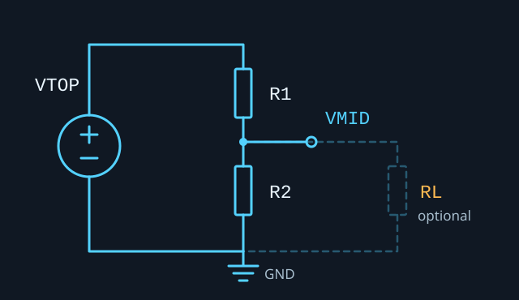

# Voltage Divider — Schematic Export (Markdown)

miniPCB · Circuit boards for electronics education

This hand-authored guide documents the calculator and includes default circuit
examples; it is not an export of the current calculator session.

The calculator toolbar's **LTspice .asc** and **Markdown** downloads are generated
from the same complete circuit currently shown in its SVG. They include every
physical resistor and its actual series/parallel/nested connections, source,
open/finite load, values, selected MPNs and analysis date. A selected combination
preview is exported as shown, without applying it to the work form. Undefined or
invalid circuits and search setup without a valid preview have no download links;
old files are cleared instead of falling back to the default circuit.

The LTspice schematic uses standard voltage, resistor and current-source symbols and an ideal nominal
DC operating-point analysis (`.op`). An open load is omitted. Values use full
numeric precision in ohms/volts, avoiding SPICE suffix ambiguity. Tolerances,
ratings and selected part numbers appear as annotations; they do not implement
tolerance sweeps, temperature drift, derating or failure models in LTspice.
Temperature annotations use plain `C`, such as `70 C` and `25 ppm/C`, to avoid
degree-symbol encoding artifacts in LTspice.
Its **Operating Point Report** lists VTOP, VMID, equivalent RTOP and RBOT,
total operating power (including a connected load), and nominal Pstress/Vstress.
Each aggregate stress is the highest utilization among the physical RTOP/RBOT
parts; the load's rating is not assessed. Individual stresses appear beside
each resistor. Missing voltage ratings are labeled **not assessed**, and a
partial set of ratings is not presented as a complete Vstress result.

Run `.op` and open **View > SPICE Error Log** for the measured report and
individual part stresses. Measurement names ending in `_pct` contain percentages.
The measurements use simulated node voltages and resistor currents; RTOP/RBOT
use the exported nominal equivalents when the source is zero. If any working
voltage rating is missing, `Vstress_unassessed_parts` reports that count instead
of a misleading aggregate percentage. The native `.op` node/current dialog
continues to show electrical quantities.

The Markdown download contains the current characteristics, date/calculator link,
physical connection table, Mermaid connection diagram, SVG BOM with separately
labeled unapplied alternatives/recommendations, and the matching nominal netlist.
These generated files are snapshots; later calculator edits require a new download.

## Framed circuit images

The editable circuit title and schematic sit inside a frame using the original
repository `logo.png`. The format picker uses the same logo, and downloads embed
the original PNG bytes for offline use.
Below the logo, published builds show a UTC build date/time and short Git commit
ID. Click the stamp to open that exact public GitHub commit. GitHub Pages fills
`calculators/build.json` from its build time and `site.github.build_revision`;
the calculator does not query the latest repository commit at analysis time.
The stamp stays fixed while inputs, selections and viewport size change, and
remains visible in SVG, PNG, JPEG and BMP downloads. The separate **Analyzed**
characteristic records the calculation time. Plain local previews or unavailable
build metadata are explicitly marked **unpublished source**, with the analysis
time shown instead of claiming a published revision.
Its **Download circuit** button opens an icon picker for **SVG**, **PNG**,
**JPEG** and **BMP**. The image includes the title, physical resistors, load,
voltage readouts and operating conditions. The BOM, workspace summary, graphs,
color key and action buttons stay outside this download. The existing toolbar
**Download SVG** still exports the full workspace.

SVG remains vector. PNG is lossless; JPEG uses high quality; BMP is an
uncompressed 24-bit image. Raster files normally render at twice the circuit's
size, with an 8192-pixel edge / 16-megapixel limit for very large networks.
All formats use the same dark background and keep the complete frame, including
circuit areas outside the screen on a phone. The title supplies a safe filename.

The picker captures the diagram when it opens, including a selected combination
preview or unknown fields in search setup. It removes live editors and controls;
no diagram values are changed or applied. Escape or Close cancels the picker,
including a conversion in progress. A failed image conversion keeps the format
choices available for retry. Image generation stays in the browser.

## Current-source load and sense-pin leakage

Click the load symbol or its **RL/IL** selector and choose **Current source**.
Its value and tolerance edit directly on the SVG. The defaults are **0 µA** with
an **absolute ±0.1 µA** tolerance, suitable for entering a specified leakage
range of −0.1 to +0.1 µA. Positive IL flows from VMID toward ground; negative
IL injects current into VMID. Switching models retains the parked resistance
and the previously entered current settings. The **Find RL** calculator becomes
**Find IL** while this model is selected.

With `Rth = RTOP || RBOT`, the nominal current-loaded equations are:

- `VMID = VTOP × RBOT / (RTOP + RBOT) − IL × Rth`.
- `VTOP = VMID × (1 + RTOP / RBOT) + IL × RTOP`.
- `RTOP = (VTOP − VMID) / (VMID / RBOT + IL)`.
- `RBOT = VMID / ((VTOP − VMID) / RTOP − IL)`.
- `IL = (VTOP − VMID) / RTOP − VMID / RBOT`.

Resistor solutions must still be positive and finite. With an active current
source, nominal VMID is not necessarily confined between ground and VTOP.
The displayed **Resistor gain** is the proportional voltage term; IL adds an
independent offset. **Source power** is signed net power drawn from VTOP, and
can be negative when an injecting source returns power to that supply.

Worst-case VMID checks `ILnom ± ILtolerance` at every source/resistance interval
corner. It combines the absolute current range with the full resistor tolerance,
temperature and aging stack; current tolerance is not a percentage of nominal
current and remains meaningful at zero nominal IL. Voltage readouts gain enough
precision to show small leakage intervals. For exact 10 kΩ / 10 kΩ resistors at
12 V, 0 µA ±0.1 µA gives **5.9995–6.0005 V**. The user's IL range is an independent
specified limit; no IC-specific thermal, aging or nonlinear leakage model is inferred.

Find VTOP propagates the known VMID threshold interval through the inverse
`VTOP = VMID × (1 + RTOP / RBOT) + IL × RTOP` at every resistor/current corner.
Min and Max are the actual trip-voltage endpoints, which may be asymmetric;
the displayed tolerance is the larger deviation from nominal. A tighter threshold
still has a finite resistor/leakage trip range. This is not a budget of allowable
supply variation. VMID remains the specified threshold interval, so derived
VTOP uncertainty is not fed back as an independent input and counted twice.
Threshold stress checks preserve this correlation. Network part stresses and
total source power retain conservative envelopes. Ordinary calculations,
catalog previews, automatic selection and both combination-search paths use
the same full resistor intervals and independent current range.

SVG, Markdown and search CSV retain the model and absolute current tolerance.
The LTspice export uses `ILOAD VMID 0 DC <amps>` and a real `current` symbol;
its R0 pin offsets `(0,0)` / `(0,80)` follow
[ADI's schematic reference](https://github.com/analogdevicesinc/ltspice-reference/blob/main/ai_ref/SCHEMATIC-REFERENCE.md).
The measured report includes `Load_current_A`. As with resistor tolerances,
`.op` simulates nominal current only; calculator bounds and tolerance annotations
describe the uncertainty rather than silently adding a simulation sweep.

After circuit edits or resistor-combination searches, leaving, refreshing or closing the
page requests the browser's standard confirmation so you can stay and keep your
work. This includes changes made through the SVG and unfinished SVG edits.
Restoring the original circuit and search defaults clears the warning when no
search results or assigned parts remain. Switching result tabs, copying tables
and downloading files keep your work on the page. Circuit data is not saved
between visits; the browser controls the warning text and requires prior user
interaction before showing it.

Right-click a physical RTOP/RBOT resistor in the live SVG to add a resistor in
**series** with it or in **parallel** across it. Focus the resistor and press
**Shift+F10** for the same menu; arrow keys select an action and Escape closes
it. Additions apply to that resistor, so an arm can contain nested series and
parallel branches. The drawing, equivalent resistance, per-part currents,
powers, tolerance limits, stresses and BOM use that actual connection tree.
The work form shows **Mixed · follow schematic** for a mixed arm; choosing
Series chain or Parallel bank reconnects every resistor in that arm accordingly.
Remove prunes the selected resistor and collapses one-member branches.
**Find real resistor combinations** can reuse this construction, or you can
right-click its search SVG to build an independent network before applying it.

New resistors inherit the selected resistor's value, tolerance and package.
They stay immediately editable and keep the circuit calculated. If no setting
is available, the defaults are 10 kΩ, ±0.1% and 0805. Adding a resistor places
the cursor in its value; type directly, then press Enter. Tab saves and moves
to the next resistor's value, allowing a chain of values to be entered quickly.
**Find Design Solutions** below the circuit searches catalog assignments for
the same construction without opening a dialog.

The advanced **Automatic values** section inside **Options** lets you set target VMID, a
preferred nominal error, catalog family, footprint, TCR and starting RTOP + RBOT.
Each physical resistor retains its own tolerance selection. Use the context menu
or each part's checkbox to mark other resistances automatic; **Make all resistors
automatic** includes both arms. Select one automatic resistor as the **ratio
trim**. **Keep the current value fixed** converts a chosen value into an input.

The first picking rule seeks similar **nominal dissipated power** across all
non-trim RTOP/RBOT resistors, including fixed resistors. It samples power scales and
refines discrete catalog choices, then inverts the trim resistor's connection
path and checks neighboring catalog values to approach the requested divider
ratio. It prefers results inside the nominal error band and then lower power
spread; if no searched candidate meets the band, it reports the closest result
found and labels it **outside preferred band**. The spread is the non-trim
maximum minus minimum power, divided by their mean. Starting resistance sets
the initial scale and breaks otherwise equivalent choices; it is not a hard
total-resistance constraint. The search is bounded, not exhaustive or a proof of
the globally best catalog combination.

Automatic choices use the shared TNPW or M55342-family catalog and its supported
ordering rules at 70 °C. The chosen footprint determines power/voltage limits;
nominal per-part stress must remain within those limits. Source/load and
component tolerances remain part of the circuit analysis; the preferred design
band is nominal, unlike the combination search's worst-case band. Review
the resulting tolerance interval and stresses. Supplier stock is not checked.
Actual selected values and MPNs appear in the SVG and copied BOM; the resistance
input retains its starting value, with the chosen automatic value also shown
in its placeholder. Edits invalidate old choices and clear stale
analysis until values are chosen again. Switching Find modes fixes already
chosen resistances before the ordinary solver runs. Reset defaults clears
construction, automatic roles and chosen parts. SVG downloads preserve the
connection drawing as a static snapshot.

The calculation choices appear above the live circuit SVG. Each choice lists
**Given** inputs and the value to **Find**; the form and diagram use the same
**Find** wording. The SVG updates VTOP, VMID, the equivalent arm resistances,
and the open/finite RL value as you edit.
The main page ends at the circuit region: the former lower forms, result panels,
instructions and footer no longer appear beneath the SVG. Click diagram inputs
and pills for their focused editors. The toolbar above the SVG shows only its
download buttons in every mode. A large, centered title sits directly above the
schematic; click it to edit it in place. It defaults to **Voltage Divider**,
accepts up to 80 characters and is included in the SVG download. Title changes
participate in leave protection and circuit reset restores the default.
The dynamic circuit summary remains the region's accessible label.
The neutral **Options** button beside Known/Unknown is the only entry into the
large Circuit options dialog. Its section selector exposes Circuit, Automatic
values and Tables. Ordinary value, tolerance and package edits stay on the SVG;
invalid inputs and clipboard failures never open Circuit options automatically.
These controls reuse the original state and calculation rules.
Done or Escape returns to the diagram, and calculation/search submission returns
to the SVG. Form reset actions restore defaults for the current circuit/search mode.
Errors, search progress/results and automatic-value status remain in their
existing dialogs and accessible status announcements, without visible paragraphs
above the SVG. Download links sit above the drawing.
Voltage readouts are part of the circuit drawing. Both panels start with the net
name, followed by **Target** (or **Calculated** for a solved voltage),
**Tolerance**, **Max** and **Min**. A VMID target also retains a **Nominal** row
so the selected design's actual output can be compared with its target.
Known VTOP bounds use the entered source tolerance. **Find VTOP** instead shows
the supply trip-voltage range from the known VMID threshold tolerance, each
physical resistor's initial/temperature/aging/radiation interval, and load
uncertainty. Its calculated tolerance is read-only and reports the larger
endpoint deviation. Min/Max retain the actual, possibly asymmetric endpoints;
a previous source-tolerance input does not constrain this inverse calculation.
Negative limits stay ordered. Zero nominal VTOP uses an absolute voltage
tolerance, including any nonzero range caused by leakage uncertainty. Missing
required drift coverage says **Unassessed**; a narrow threshold tolerance does
not make the computed trip range unavailable.
In inverse modes and combination searches, VMID Target and
Tolerance are editable specifications, and Max/Min show that required band; the actual nominal
output remains separate, with its actual tolerance interval available in the panel
tooltip, result tables and SVG description. Calculated VMID shows the computed
tolerance and interval. Combination searches also report the target-error budget
above VMID.
Editable values have brighter borders and shading; calculated fields have quieter
borders. The old dotted underlines and small Find labels in these panels are removed.
VMID sits
at the end of an output wire extending just past the RL branch. The entire VMID
net uses one color throughout: red when VMID is unknown and blue when it is known,
including resistor terminal leads, connected parallel-network buses, the load
branch and junction dots. Every three-way or
higher wire junction has a connection dot; ordinary bends and unconnected crossings
do not. Voltage readouts retain their known/calculated role colors.
A separate, spaced VMID readout lists **Nominal**, **Min** and
**Max** voltages for both normal calculations and combination previews. Its minimum and
maximum use the same entered tolerance limits as the analysis results. Combination
previews show **worst-case VMID error** in larger text above the VMID box, with the
allowed limit below it. Green, amber and red indicate the share of the allowed
error used; no selected solution shows a dash. These percentages are outside the
voltage-readout box. Invalid circuit data clears all three
values. Calculated voltages are read-only; an entered VMID target remains editable
in inverse modes. The readouts retain their role colors and appear in the
standalone SVG download.
VTOP is drawn as a positive supply-net symbol named **VTOP**, with RTOP below it
and the divider returning to ground through RBOT. The displayed supply symbol
does not change the DC source used in the circuit calculation or LTspice export.
Each physical RTOP/RBOT resistor is annotated with its resistance, tolerance,
footprint size, power rating, Pstress and Vstress. The drawing contains
one vertical European (IEC rectangular) symbol per physical RTOP/RBOT resistor in
the work form, matching the load resistor style. Series
parts stack vertically; parallel branches sit side by side, with every resistor
still vertical. Nested networks use the same layout without rotating or squeezing
their symbols. A finite RL shows its load symbol at full opacity. An open RL
retains a faint, unfilled rectangular symbol with normal leads and an **Open**
label; this is a visual placeholder and adds no load to the calculation or
LTspice circuit. Each drawn part shows a large value field and two controls for
tolerance (for example, **±1%**) and package size (for example, **0805**), without
repeating Tol. or Footprint labels. Editable tolerance and footprint pills have a subtle
border and dropdown chevron; the entire pill area is clickable and keyboard accessible.
Hover/focus identifies the control.
Accessible labels and reference tooltips retain the full parameter names.
Packages start at **0805**, independently of the manual power rating; this
physical footprint does not assign a catalog part number or infer a rating.
Equivalent arm labels allow total-resistance editing when that arm is an
input; calculated arm values are read-only.
Ordinary electrical nets and ground use blue throughout, including internal
series/parallel connections. A calculated VMID or VTOP net uses red. The resistor,
supply and load symbols keep their known/calculated role colors, with a consistent
20 px lead between each symbol body and its net. Long connection runs use net
color. Connection dots mark actual branch junctions; symbol sizes stay unchanged.

VTOP, RL and every physical resistor have rounded, borderless information boxes
matching the VMID readout. Parallel-bank boxes keep the resistor symbols and
connections visible. The **Parts list and electrical part stress** table contains **Ref Des**,
**TNPW PN**, **M55342 PN**, **Description**, **Pstress** and **Vstress**
columns and one row per physical resistor. The copied BOM also places Description
after both family part numbers. Table and copied-BOM stress percentages use two
decimal places, rounding tiny values to **0.00%** without scientific notation;
unassessed voltage stress remains a dash. The description shows actual resistance,
tolerance and footprint; unassigned footprints read **Footprint not set**. On
smaller screens, each reference and description sit above the part-number and
stress cells so the table stays readable without horizontal scrolling.
Table type scales with the available table width, from 12 px in compact layouts
to 16 px in wider layouts. Headings, secondary text, column spacing and row
heights follow the same scale; long part numbers wrap at a readable size.
The SVG download retains this typography and spacing.
An asterisk marks the selected
part number; stress uses the current circuit or preview part's own ratings.
A dash means no assigned or qualifying part number for that family. Click a
reference to edit the resistor and its catalog options. Reference tooltips retain
value, tolerance, footprint and rating; part-number tooltips retain each family's
independent limits and conditions. The table is included in Download SVG.
Ratings are not combined. Stress
values use the nominal operating point and include each part's working-voltage
limit when entered. Invalid circuit data clears the live values and stresses.

The components use **yellow** for missing/invalid inputs or an unspecified
footprint, **green** for known information, and **red** for the value to find.
The active mode and **Target**/**Calculated** labels identify the calculation
without relying on color; the net panels do not repeat a small Find label. The selected calculation,
form inputs and result use the same cues; a calculated value stays red to identify
its role. A blank optional RL is a known open circuit. Multi-part arms highlight
all resistors being scaled. Combination previews highlight the candidate RTOP/RBOT in
red. Without a selected combination, the diagram shows combination-search inputs and unknown
resistor values instead of the applied circuit.
Stress colors continue to describe rating limits independently of input roles.

Part-number tooltips include resistance alongside the part's operating limits;
both graph hover readouts also show the resistance of each part. The **Copy BOM**
pill below the SVG parts table copies the displayed physical resistors as a
spreadsheet-ready table, including quantity, resistance, tolerance, footprint,
selected part number, both family part numbers and nominal P/V stress. In combination
mode it copies the preview without applying it to the circuit. If clipboard
access is unavailable, the text is selected below the diagram for manual copying.

The SVG BOM shows exact resistance/tolerance matches even before a catalog part
has been applied. Unassigned parts use the package, ambient and TCR selected in
**Parts (2)** for suggestions; assigned parts retain their own package and
conditions. If a family has no exact match, its cell shows an amber **Nearest**
recommendation with the proposed resistance, signed percentage change, tolerance
and footprint. Unsupported tolerances are visibly labeled **Tolerance change**.
The nearest resistance uses the current tolerance where supported. Otherwise,
the closest supported tighter tolerance is preferred; a looser tolerance is shown
only when no tighter option exists.

**Use** adopts that one physical resistor's resistance, tolerance, footprint,
power rating, working-voltage limit and real part number, then recalculates the
circuit and BOM while preserving the active Find mode. Calculated Find values
remain read-only. Over-rating or infeasible recommendations cannot be applied;
their tooltip shows the candidate's limits and preview result or reason.
In the two-resistor search, **Preview** selects a validated visible combination
with the other resistor unchanged. Network previews also show exact-value
other-family matches when a full-combination substitution passes the limits;
these are unapplied informational matches. **Apply combination** transfers the
selected complete result to the circuit.

**Copy BOM** includes the description and assignment status. Exact matches appear
in the family PN columns; nearby-value or different-tolerance proposals appear
in separate **recommendation (not applied)** columns, preserving the actual
values and selected PN until adoption. Static SVG downloads keep descriptions
and recommendation labels while removing live adoption controls.

Click a bordered SVG value or a pill, or focus it and press Enter/Space, to
edit the circuit. VTOP edits voltage and source tolerance inline; RL edits resistance and load
tolerance (blank resistance means open circuit). Click a physical resistor's
value to type **directly on the SVG**. A live list shows the six nearest catalog
values to the resistance being typed, respecting the selected part's family,
footprint, tolerance and TCR. Bare numbers use the unit shown beside the field;
explicit units such as `499R`, `4k99`, `12.3 kΩ` and `1M` override it. Click a
suggestion to apply it, or use the arrow keys and Enter. Enter or the checkmark
without selecting a suggestion applies the typed value; manual parts allow
arbitrary positive resistances. Tolerance and footprint retain their direct
native dropdowns. All selections use the full editor's catalog and stress checks.
The same text entry and suggestions apply to each physical resistor in series,
parallel and mixed networks. Editing one part preserves its siblings and the
connections, and recalculates the arm equivalent, operating values and BOM.
Single, series and parallel resistors use the same three populated controls,
without visible field labels. Accessible names identify each value, tolerance
and package. The schematic grows to fit these controls; symbols remain vertical
and retain their normal size. Inverse-calculated resistances remain read-only.

Escape cancels. Invalid choices show a local inline message and preserve the
circuit. An unfinished resistance draft participates in leave-page protection.
Moving focus away cancels it. The explicit **Options** button below a value's
nearby list opens the part dialog for family, TCR, reliability
and other specifications. M55342 offers catalog reliability codes; TNPW displays
**Not applicable**. Footprint, TCR and tolerance choices follow the selected
family's supported combinations. A live part-number preview shows the result.

Power is read-only in the SVG editor and follows the selected catalog part's
footprint, operating mode and ambient derating. Catalog working-voltage limits
also update automatically. Saving applies the validated part number, tolerance,
power and voltage limits to the circuit and BOM. Unsupported exact catalog values
cannot be applied; parts exceeding power/voltage limits apply with a **FAIL** status.
Existing catalog
parts reopen with their reliability, TCR, tolerance, footprint and conditions.

For an unassigned resistor, **Manual · keep current limits** preserves its current
power rating and offers a tolerance dropdown and optional working-voltage input.
Footprint and editable tolerance controls include dropdown chevrons. Selecting
a size applies a compatible catalog family and its actual limits. **Options** keeps the family
editable. A family can also be selected first for its footprint, TCR and
reliability choices. Manual mode permits custom values and clears a prior catalog
assignment when explicitly selected. Source/load tolerances retain numeric entry.
If a manual value has no exact supported catalog part, a package choice records
the physical footprint and manual tolerance while updating power and voltage to
conservative references for that package;
the part number remains unassigned. This also permits independent footprint
selection for values produced by splitting an arm, such as 2.5 kΩ.
Applying a selection or saving advanced changes updates the existing forms and
recalculates the selected result and stress
while preserving the active Find mode. Cancel or Escape leaves the circuit unchanged.
Inline choices use the same validation and failure indicators. In the
real-combination mode, footprint and tolerance choices update that arm or
physical resistor's search constraints and invalidate changed results; run
**Find Design Solutions** to generate replacements. They do not apply a preview
to the circuit. Calculated resistance and tolerance retain their existing locks.

In inverse modes, click VMID to edit the entered target; the calculator tab
selects whether VTOP, RTOP, RBOT or RL should be found. A calculated value has no edit link
or keyboard button, including individual resistances in a calculated multi-part
arm. Other specification editors keep calculated values and units read-only;
calculated tolerance selections are disabled in tolerance analysis. The selected
physical footprint persists when a recalculated resistance or tolerance no
longer matches an exact catalog part; the BOM keeps that footprint and marks the
part number unassigned. It does not invent an ordering code for the calculated
value or tolerance. Reset clears these footprint preferences. Known inputs
remain editable, and their changes recalculate the selected result.
Voltage tolerances follow the same known/calculated role in the SVG and input form:
VTOP tolerance is locked in Find VTOP; VMID tolerance is locked in Find VMID.
Find VTOP recalculates its trip-voltage tolerance and bounds after edits to VMID's
allowed band, physical resistor values/tolerances, load or operating conditions.
In inverse modes, VMID tolerance edits the allowed target-error band, preserving
the nominal circuit and Find mode. Its Max/Min are acceptance limits; the actual
output interval remains a separate calculated result. Known voltage fields remain
reachable from the SVG when invalid circuit inputs need repair.
For a multi-resistor input arm, clicking its equivalent value or connection
opens an editor that scales all part resistances together for the requested
equivalent and series/parallel connection, preserving independent ratings and
tolerances. Individual SVG rows edit just that physical resistor. Invalid edits
remain in the editor with an error and leave the applied circuit unchanged.

The schematic grows to accommodate the circuit at normal size. Its drawing area
scrolls horizontally on smaller screens or with wide parallel networks; resistor
symbols and labels are not scaled down. Operating information, the parts list and
solution plots continue using the available viewport width. The SVG download
includes the complete circuit at its natural dimensions.
**Download SVG** captures the current annotations in a standalone SVG. LTspice and
Markdown downloads capture that same complete circuit. The image below remains
a default reference. The calculator keeps its live SVG, editor, styling, logic
and export generators in the one HTML file. Downloads are snapshots without
calculator editing controls.

In the resistor-combination visualization, selecting a point or table row previews that
combination in the top SVG, including VMID bounds, error, power, current, Rth and worst
stress. Each physical resistor card has a compact **Pstress / Vstress** footer
below its value, tolerance and package controls. It shows that resistor's nominal
power and voltage utilization, matching the parts list, in nonnegative percentages
with two decimals. Green is below the limit, amber is at the limit and red is over
it. A missing working-voltage rating shows **—**, and unresolved circuits/search
setup show **—** for unavailable measurements. The tooltip identifies the nominal
basis and the individual rating. The footer stays in framed/full SVG and raster
downloads; the three editing controls keep their normal size. Matching
TNPW or M55342/D55342 alternatives appear alongside it with their own power and
voltage limits. Preview alternatives must also satisfy the combination search criteria;
other calculator views check alternatives at the nominal operating point.
Selecting a candidate preserves the applied circuit inputs and BOM. The heading
identifies the preview, and Download SVG captures it. Leaving the visualization
or selecting an empty region restores the combination-search input display.

Four large, colorful **Operating Point Information** boxes show nominal **VMID**,
**total power**, **input current** (magnitude) and **Rth** above Circuit
characteristics. Rth is the divider's source resistance, excluding RL. The boxes
follow the active Find mode or selected combination preview, clear unavailable
values, reflow on small screens and remain in the SVG download. The current
Markdown export includes the same operating-point table.

The common **Circuit characteristics** table starts collapsed in every Find mode,
beside the circuit on larger screens and above it on smaller screens. Click its
heading or press Enter/Space to expand it; this preserves the calculation and
search selection. The expanded table identifies the
calculated quantity and lists nominal total power, input current and source
resistance Rth. Every mode reports worst-case Pstress and Vstress over its
configured resistance-drift intervals. Two-part circuits use analytic extrema,
including interior power peaks; networks use conservative per-part bounds.
Applying a two-part solution retains its preview's stress basis. Find RL also shows load power; tolerance analysis shows the found
per-resistor tolerance and allowed VMID error. If any part lacks a working-voltage
rating, the overall Vstress is unassessed and the table lists how many parts have
specified ratings. An explicit maximum Vstress filter excludes unassessed parts.

The expanded table also lists the **tolerance stack**: VTOP source tolerance,
initial resistor tolerance, thermal drift, the aging/radiation allowance, the
combined resistor limit, and the resulting VMID interval. Resistance rows show
the largest per-part limit across the physical divider resistors and RL, if
fitted; **Up to** indicates that the parts have different limits. Hover details
list each part and retain any fixed-ohm aging term. These are resistance limits,
not independent percentages to add to VMID error. The VMID range uses the actual
network and load with compounded resistance limits and source tolerance.
The standard calculation is labeled **Drift estimate**. The same breakdown follows a selected solution
preview, an applied circuit, and SVG/Markdown downloads. Expansion only changes
the display; it does not recalculate or invalidate a search.

Where an independent VMID target exists (inverse modes and combination searches),
**Nominal target error** is the absolute output error divided by the target
magnitude, expressed as a percentage; **0%** means on target. **Worst target
error** uses the full minimum/maximum VMID interval. Combination searches also show the
allowed error. Find VMID instead shows **VMID accuracy**, the worst tolerance
deviation about its nominal result, without inventing a target. Zero targets and
zero nominal VMID use voltage error/variation because relative percent is undefined.
After adopting a nearby catalog part, Find VMID retains the original nominal
VMID as its reference and shows the resulting target error. Applying a resistor
combination retains that search's requested VMID target. A manual circuit edit clears
the saved reference, returning to the nominal tolerance band.

The **Analyzed** row records the successful circuit calculation or completed combination
search date and time in UTC. Filtering, resizing or choosing another combination keeps
that timestamp; recalculating the circuit or running a new search records a new
one. Missing/invalid inputs and combination setup keep the common table while clearing
unavailable or stale results. The **Calculator** link opens the voltage divider
page. The downloaded SVG follows the current expanded/collapsed view; its accessible
description and Markdown export retain all characteristics in either state.

The SVG also sets up the combination search before any results exist. Click VTOP for the
source and its tolerance, the separate **Target** row for VMID and its allowed
error, or RL for the optional load and its tolerance. Physical values are
populated starting values before search; entering a value makes it fixed for
a subsequent constrained search. Tolerance and package edit directly; family
and TCR are available through Options. In the two-part variant these use arm defaults; network
parts can have independent overrides. The arm heading edits shared defaults.
The SVG's red **Unknown** and green **Known** tiles explain its circuit colors.
Beside the color tiles, the neutral **Options** button opens Circuit options, including the resistance range,
ambient temperature, shared TCR, maximum stress and optional total-power limit.
Below the ground symbol, **Find Design Solutions** runs the combination search
directly from the diagram.
It is red when a search is needed, amber while searching and green when the results
match the current specifications, including a completed search with zero matches.
After completion, it reads **# Design Solutions Found** and stays disabled until a
search specification or design input changes. The count is the total found by the
search; filtering, previewing or changing chart axes does not enable another search.
All these controls use the same settings and
validation as the combination-search form, including when the applied circuit is invalid.

The combination diagram keeps entered targets separate from candidate nominal/min/max
results. Resistor values and nominal performance are read-only. Saving an SVG
search edit synchronizes the combination form, clears previous results when the
specifications change and waits for **Find Design Solutions**. Saving unchanged
specifications retains current results. Neither action applies a candidate or
changes the circuit/BOM. Canceling, invalid edits and stale editors
preserve the current settings and applied circuit. A search with no matches clears
old candidate annotations and leaves its inputs editable. Use the existing
**Apply** action to transfer a chosen combination into the circuit and BOM.

Below the circuit, a compact colored **Design Solutions (showing # of #)** heading
separates the design space from the circuit. It shows the number remaining after
filters out of the total valid designs found, with comma-separated counts. The
count wraps below the title on narrow screens. Detailed search counts and
bounded-network limits remain in the results dialog.
Six two-ended sliders filter total power, input current, output Rth, target error,
Pstress and Vstress. Networks add a seventh slider for non-trim power spread.
Power/current/Rth are nominal; error uses the full output interval. Network
stress uses conservative per-part interval bounds; the two-part variant retains
its analytic stress maxima. Positive power, current and Rth ranges
use logarithmic interpolation. The slider domains stay at the full search range
so filtered-out values can be restored. A gold marker on each slider shows
the currently selected combination's actual metric value and its position in
the full search range. Markers update with the selection and disappear when
no combination is selected. Sliders, numeric chart bounds, family toggles,
result rows and filtered CSV share one result selection; filters across
different metrics intersect. Axis changes clear the old coordinate bounds while
retaining other performance filters. Escape restores every range and family
when no drag is active.

Two native SVG scatter plots titled **Valid Resistor Combinations** show actual
part-number combinations, with both axes
rescaled to the currently filtered combinations. The first uses the detailed chart's
selectable axes; the second starts with Rth against Pstress. Right-click either
axis or its tick labels on either plot to choose another metric. Clicking or
tapping an axis label also opens the menu; Enter, Space and Shift+F10 provide
keyboard access. Arrow keys navigate the menu, and Escape cancels without
changing the axis. The second plot's choices are independent of the first.
Disabled families and filtered-out combinations are omitted. Hover identifies
each arm; the SVG parts table lists all physical MPNs for a selected combination.
Click a point to update the circuit preview and
table selection; clicking overlapping points cycles their actual combinations.
Dragging either plot adds its data-space bounds to the shared filters.

The bottom action row has been removed, along with its SVG-only handlers and
the former Axes dialog. Shared detailed-table, comparison, copying and Apply
features retain their existing behavior. Plot Enter no longer adds hidden
comparisons.

The summary uses separate colored RTOP and RBOT cards without a redundant heading,
with large equivalent resistance values and real part counts or selected MPNs.
The accuracy card prominently shows **worst-case VMID error**, with nominal error,
allowed error and a bar showing the share of the error budget used. Green indicates
margin; amber identifies combinations using most of the allowed error. Hovering
a graph point previews its summary without changing the selected design; the
error caption identifies the hover state. The cards and markers are retained in SVG
downloads without live axis menus or buttons.

Only Apply changes the circuit/BOM. Controls reflow on
small screens and support mouse, touch and keyboard. Slider arrows change the
range; PageUp/PageDown use larger steps, Home/End reach the endpoints, and Escape
cancels a drag or clears filters. Plot arrows select real combinations.
The standalone SVG retains native plots,
selected part numbers and range annotations with live controls removed.



[Calculator](../calculators/voltage_divider.html) ·
[Default LTspice reference (not a current-circuit export)](../ltspice/voltage_divider.asc)

## Circuit data

VTOP is the source voltage at the top of RTOP. VMID is the midpoint voltage
between RTOP and RBOT. Both voltages are measured relative to ground.

| Reference | Description | Default value | Positive node | Negative node |
| --- | --- | --- | --- | --- |
| V1 | Ideal DC source | 12 V | VTOP | 0 (ground) |
| R1 | Upper divider resistor | 10 kΩ | VTOP | VMID |
| R2 | Lower divider resistor | 10 kΩ | VMID | 0 (ground) |
| RL | Optional output load | Open; 100 kΩ when enabled in LTspice | VMID | 0 (ground) |

R1 and R2 default to 1/4 W in the calculator. Power ratings and optional maximum
working voltages are analysis inputs; the ideal LTspice resistors do not model
rating limits or failure.

## Netlist

```spice
* Default unloaded divider
V1 VTOP 0 DC 12
R1 VTOP VMID 10k
R2 VMID 0 10k
* Optional load: uncomment to enable
* RL VMID 0 100k
.op
.end
```

The `.asc` reference instead uses `LOAD_ON=0` and an RL resistance of 1e18 Ω to
approximate an open circuit. Set `LOAD_ON=1` to use the `RLOAD` parameter.

## Analysis

- `Rb = R2 || RL`, or `R2` when the load is open.
- `VMID = VTOP × Rb / (R1 + Rb)`.
- `I1 = (VTOP − VMID) / R1`; `I2 = VMID / R2`; `IL = VMID / RL` (zero for open load).
- Each resistor dissipates `P = I² × R`.
- Total dissipation is `P1 + P2 + PL = VTOP × I1`.
- The unloaded Thevenin resistance is `Rth = R1 || R2`.

At the defaults, VMID is 6 V, I1 and I2 are 0.6 mA, and R1 and R2 each dissipate
3.6 mW. Total power is 7.2 mW and Rth is 5 kΩ.

## Solve modes

RTOP is R1 and RBOT is R2. The calculator can solve for VMID, VTOP, RTOP, RBOT,
or RL while the remaining nominal quantities are held at their entered values.
Choose a calculation button at the top of the page. The sixth button,
**Find real resistor combinations**, searches actual catalog parts for a target VMID.
Each circuit-analysis view names the goal, explains its inputs, and shows a
matching equation and Calculate action in the Options dialog. Only known quantities
appear as primary inputs; the SVG and detailed result banner show the calculated quantity. Switching views
preserves circuit data.

The **Details & tables** dialog uses **Overview**, **Tolerances**, **Stress**,
**Ratings**, **Parts**, **Parts (2)**, **Resistor combinations**, and **Method** tabs to show
one focused panel at a time.
The solved value stays visible above the tabs; all results continue updating as
you edit. Switching result tabs preserves circuit data and selected parts.
Combination searches open **Resistor combinations**; circuit calculation choices open
**Overview**. The Calculate action opens the relevant result view, and Reset
restores **Overview**. Use Left/Right Arrow, Home, or End to navigate the tabs
with a keyboard. The main page and its print view keep the circuit SVG prominent;
closed dialogs do not add the old lower panels to the printout.

Output load and tolerance/rating settings are collapsible. Combination searches have
their own target and tolerance form. An invalid setting automatically opens its
containing sections so it can be corrected. The page styling and integration
remain in the HTML file; current-load interval mathematics, shared part catalogs
and the numbering engine are loaded separately.

For the resistor-load model:

- VMID uses the loaded divider equation above.
- `VTOP = VMID × (1 + RTOP / Rb)`.
- With `g = VMID / VTOP`, `RTOP = Rb × (1 − g) / g`.
- To solve a lower resistance, first calculate `Rb = RTOP × g / (1 − g)`.
- Unloaded: `RBOT = Rb`. Loaded: `RBOT = Rb / (1 − Rb / RL)`.
- To solve the load: `RL = Rb / (1 − Rb / RBOT)`.

Resistor-load resistance solutions require the same sign for VTOP and VMID with
`0 < abs(VMID) < abs(VTOP)`. A passive load cannot increase the unloaded output
magnitude. The load solution is open circuit when the target equals the unloaded
output. Zero, negative, infinite, and otherwise infeasible resistance solutions
are rejected. Solved resistances are exact design values, not rounded to a
preferred component series.

## Multiple physical resistors per arm

Open **RTOP parts** or **RBOT parts** and enable **Use multiple resistors** to
replace that single resistor with a series chain or parallel bank. When solving
for an arm, its construction settings remain available below the known inputs.
Each physical part has its own resistance/unit, power rating in watts,
tolerance, and optional maximum working
voltage. Each part has a compact resistance/rating/tolerance summary that opens
for editing; adding a part opens it, while the four-part shortcut initially
opens only the first part. Add/remove controls keep at least one part in an
active arm. The two arms may use different connection types; nested
series/parallel networks are not supported.

The **Split into 4 equal parts** shortcut is available for a one-part arm. It
preserves nominal equivalent resistance: each series part becomes one quarter
of the original resistance; each parallel part becomes four times the original.
New parts copy the existing part's rating, tolerance, and working-voltage input.
Edit those values for your selected components. A package such as 0805 does not
uniquely specify power, tolerance, or working voltage.

- Series: `Rarm = sum(Ri)`, `Ii = Iarm`, `Vi = Iarm × Ri`.
- Parallel: `Rarm = 1 / sum(1 / Ri)`, `Vi = Varm`, `Ii = Varm / Ri`.
- Each physical part dissipates `Pi = Vi × Ii`; its stress uses its own rating.
- Part powers sum to arm dissipation. Displayed arm totals already include their
  parts; the total circuit power does not count them twice.

The arm resistance and equivalent tolerance become calculated fields. Single
resistor rating/working-voltage controls are replaced by the per-part controls.
Power ratings are never pooled into a combined rating that could hide an
overloaded part. The common-rating comparison lets you choose one physical part
from each arm and includes custom power ratings entered for the selected parts.

Solving RTOP or RBOT scales all its physical resistances by the same factor,
preserving their ratios and each part's entered rating and tolerance. This is a
proportional design solution, not a search for standard resistor values. Parts
and their ratios remain available after an infeasible target so it can be fixed.
Turning an arm back to a single resistor retains the equivalent nominal value;
re-enabling the network restores its part list. Reset removes all networks.

For example, RTOP can be four 2.5 kΩ series resistors with RBOT = 10 kΩ and
VTOP = 12 V. Each upper part then drops 1.5 V, carries 0.6 mA, and dissipates
0.9 mW. If each is entered as 0.125 W, its Pstress is 0.72%. The 0.125 W value is
an example input, not a rating assigned to all 0805 components. Four 40 kΩ parts
in parallel give the same 10 kΩ arm, with 6 V and 0.15 mA per upper part.

## Tolerance analysis

For **Find VTOP**, propagate the VMID threshold bounds through
`VTOP = VMID × (1 + RTOP / RBOT + RTOP / RL) + IL × RTOP`, omitting the RL
term for an open/current-source load and using `IL = 0` for a resistor load.
Evaluate both threshold endpoints with every independent RTOP/RBOT/RL interval
endpoint and both current endpoints. Resistance intervals already include the
initial, thermal and aging/radiation terms for every physical part. The minimum
and maximum required VTOP are the trip-voltage limits. The tolerance is
`max(|VTOPmin − VTOPnom|, |VTOPmax − VTOPnom|) / |VTOPnom|`; it is absolute volts
when the nominal source is zero. It is not capped or rounded down as a supply
budget. For equal 1% resistors and a 6 V ±5% threshold, nominal VTOP is 12 V
and the trip interval is **11.2871287–12.7272727 V** (maximum deviation ±6.06%).
The known VMID bounds remain 5.7–6.3 V. Stress uses the corresponding threshold
and resistor/load corners rather than varying the derived source independently.
Downloads retain this same interpretation and interval.

Independent VTOP, R1, R2, and RL tolerances range from 0 to 99.999 percent. Each
input varies over `nominal ± abs(nominal) × tolerance / 100`. Defaults are ±0.1%
for R1/R2, RL and both catalog-search arms, and 0% for VTOP. New physical
resistors inherit the current arm tolerance. Open loads ignore RL tolerance.

Minimum gain uses R1 high, R2 low, and RL low. Maximum gain uses R1 low, R2 high,
and RL high. Combining these gains with both VTOP endpoints gives exact
worst-case VMID bounds for the ideal resistive model, including negative sources.
Largest deviation is the larger endpoint distance from nominal VMID, divided by
`abs(nominal VMID)`. It is undefined for zero nominal output.

At the defaults, ±0.1% R1/R2 gives VMID from 5.994 to 6.006 V. A ±5% output error
band around a 6 V target therefore includes that divider. The combination search checks
the full interval against the target band, including any nominal output mismatch.
The operating-point and parts-list measurements remain explicitly nominal;
Circuit characteristics reports the configured worst-case stress bounds.

For multiple-part arms, the minimum/maximum equivalent resistance is evaluated
using every physical part's own lower/upper resistance limit. Series endpoints
sum; parallel endpoints use the reciprocal conductance sum. Unequal parallel
tolerances can produce an asymmetric interval around nominal resistance. The
equivalent tolerance field reports the larger relative deviation, while the
output calculation uses the actual asymmetric interval. Tolerance tables show
both arm intervals and the individual part intervals.

These are independent worst-case limits, not a statistical average: four equal
1% parts still allow a 1% equivalent arm excursion when they all vary together
in the same direction. The same interval pipeline now covers manual circuits,
inverse modes, common-tolerance solving, candidate previews and both search paths.

## Operating conditions and tolerance estimates

The **OPERATING CONDITIONS** box below VTOP contains five native dropdowns directly
on the SVG: minimum and maximum ambient temperature, TCR in ppm/°C, radiation
tolerance and aging tolerance. No operating-conditions dialog or dialog link is
present. Changes apply immediately and invalidate previous design solutions;
selecting the current value preserves the results. Common values are populated,
and existing nonstandard values remain selectable. Invalid temperature ordering
shows an inline error and keeps the previous valid settings.

The temperature default remains −55 to +70 °C. Temperature drift includes the
existing self-heating allowance (10 °C by default); catalog power also follows
maximum ambient temperature. TCR defaults to **25 ppm/°C** and offers numeric
choices only. The selected TCR sets an engineering allowance: an assigned part's
higher ordered TCR is retained, so this cannot
improve its actual specification or silently change its MPN. Unassigned parts
and RL use the selected TCR. Reference temperatures remain 20 °C for TNPW and
25 °C for M55342/unassigned parts.

Radiation and aging are separate, editable resistance percentages, both defaulting
to **±0.1%** for every part and RL. Both dropdowns offer numeric values only.
The selected aging percentage replaces the entire aging estimate, including any
fixed-ohm endurance term. It does not add a second aging term. These are design
allowances, not radiation or lifetime qualification.

Older configurations with per-family aging estimates retain these catalog
endurance benchmarks; new designs use the selected numeric allowance:

| Family / operating mode | Automatic allowance | Benchmark basis |
| --- | --- | --- |
| TNPW general | ±(0.05% of resistance + 0.01 Ω) | 1000 h endurance |
| TNPW power | ±(0.1% of resistance + 0.01 Ω) | 1000 h endurance |
| TNPW advanced | ±(0.2% of resistance + 0.05 Ω) | 1000 h endurance |
| M55342 | ±0.5% | MIL 2000 h endurance requirement at 70 °C |

These are engineering estimates, not a mission-life or radiation qualification.
TNPW's absolute-ohm term remains absolute in the bounds and therefore has more
effect on low resistances. Reliability/screening codes do not improve a drift
estimate or imply radiation qualification. Radiation is a separately selected
allowance; no dose-to-drift response is assumed or inferred from catalog aging
tests. Unknown future families still need their own estimate data.

For initial tolerance `t`, aging fraction `a`, fixed aging drift `b` ohms,
thermal fraction `h`, and independent radiation fraction `r`:

`h = |TCR| × max(|ambient_min − Tref|, |ambient_max + rise − Tref|) / 10⁶`

`Rmin = (Rnom × (1 − t) × (1 − a) − b) × (1 − h) × (1 − r)`

`Rmax = (Rnom × (1 + t) × (1 + a) + b) × (1 + h) × (1 + r)`

Every calculator mode and solution search propagates these bounds through the
physical series/parallel network, source and load. Find VTOP retains its inverse
trip-voltage interpretation. Assigned parts stay in place; limits exceeded under
the new conditions show FAIL. Circuit characteristics and SVG, Markdown, LTspice
annotations and CSV exports preserve the independent terms. Static circuit images
show the selected values and omit the native controls. LTspice `.op` remains the
nominal ideal circuit. Inputs participate in leave-page protection.

References reviewed 1 November 2026: [TNPW e3](https://www.vishay.com/docs/28758/tnpw_e3.pdf)
(pp. 2, 12), [E/H M55342](https://www.vishay.com/docs/60018/eh.pdf) (pp. 1, 3).

## Finding real resistor combinations

Choose **Given VTOP, VMID, tolerances, construction - Find real resistor
combinations**. Set source/target voltage, source tolerance, allowed target
error and default catalog limits for each arm. VTOP and VMID need the same sign,
with `0 < abs(VMID) < abs(VTOP)`. Source and load settings belong to the search;
previewing and editing search construction do not change the applied circuit.

**One resistor per arm** retains the exhaustive search over supported preferred
values in the inclusive resistance range. It checks both catalog families,
same-family and mixed-family combinations, and analytic worst-case stress
maxima including interior resistance values where power peaks.

**Series / parallel networks** searches a complete physical construction,
including nested branches. Entering this Find mode with a multi-resistor circuit
imports that construction; **Use circuit construction** loads it explicitly.
You can also right-click any resistor in the search SVG to add series/parallel
parts without altering the applied circuit. Newly added resistances are unknown.
The original two-resistor case remains available in the construction selector.

**Find every resistor value** searches all physical values. **Keep entered fixed
values** retains imported manual resistances and varies automatic resistors.
Use the context menu to mark a resistor automatic, select it as ratio trim, or
fix its current previewed value. A fixed value must have a real supported catalog
part within the selected constraints; unsupported fixed values produce an error
rather than a fabricated part number. The ratio-trim selector lists the free
resistors. With no free values, the search checks catalog assignments for the
fully specified network.

Family, footprint, tolerance and TCR fields are arm defaults. Each physical SVG
reference or specification pill can open an individual catalog-limit editor.
Those overrides take precedence; other parts retain their defaults. Imported
construction preserves each part's tolerance and any known footprint/TCR.
Ambient, power modes and compatible ordering rules determine actual allowed
power and voltage. Independent fixed ratings are not pooled into an arm rating.
Supplier stock is not checked.

The network search samples nominal power scales, maps near-equal power values
onto the connection tree, and chooses nearby real catalog values. One designated
resistor trims the ratio. It checks multiple family patterns, including families
mixed within one arm, and retains distinct MPN combinations. **Maximum non-trim
power spread** optionally limits `(maximum - minimum) / mean * 100` for all
physical divider resistors except the trim. The same statistic has a plot axis,
SVG slider, sort option and optional comparison column.

Network enumeration is bounded: up to 1,000 power scales, 25,000 checked distinct
assignments and 5,000 retained results. The status reports the checked/retained
counts and any reached budget. Additional valid combinations may exist; this is
not an exhaustive search or proof of the globally best design. Narrow constraints
or use the performance filters to examine a useful subset.

Every retained result must fit its **entire VMID interval** inside
`target +/- abs(target) * allowed error / 100`. This includes nominal ratio
mismatch, source variation, each physical tolerance and finite-load tolerance.
For networks, equivalent resistance intervals follow the actual connection tree.
Per-part voltage/current intervals propagate through series and parallel
branches; their conservative power/stress bounds include possible interior power
peaks. They can reject a feasible design when the bounds are loose, but do not
substitute nominal arm stress for individual resistor limits. The SVG analysis
table and result status identify **Conservative interval bounds**. The ordinary
parts table still shows nominal per-part stress; Circuit characteristics reports
the environmental worst-case bounds. Total power includes RL; its rating is not
checked. Thermal/aging/radiation drift follows the environmental inputs above;
TCR tracking is not assumed.

Each plotted point represents one complete real-part combination. Click a point
or result row to preview all physical symbols, individual descriptions/MPNs and
nominal stress in the top SVG. The characteristics table reports actual target
accuracy, aggregate stress bounds and non-trim power spread. Other-family exact
MPNs are shown alongside a selected part when substituting that part also passes
the complete combination constraints; they are marked as unapplied matches.
Sorting and pagination operate on complete combinations, with 50 result rows per
page. Result cells list all physical parts in each arm.

Drag a rectangle on either plot, use SVG performance sliders, or enter numeric
bounds to filter the same result set and table. **All TNPW**, **All M55342** and
**Mixed families** classify the entire physical combination, including mixing
inside an arm. The plots autoscale to the visible results. Points with identical
performance can overlap and can be cycled. Clear filters restores found results;
search input or construction edits clear stale results and comparisons. Edits or
cancellation also prevent an older asynchronous search from publishing.

**Compare** keeps multiple combinations in selection order. The comparison table
and **Copy table** contain one standard BOM row per physical resistor, grouped by
option. Optional columns include real ratings, TCR/reliability, nominal operating
values, conservative per-part stress bounds, target accuracy and power spread.
Text/performance filters keep complete options together. Copy includes only
visible rows and selected columns, with a manual-copy fallback.

**Download filtered CSV** includes exactly the visible combinations;
**Download all combinations CSV** includes every retained result. Network CSV is
long-form: one row per physical resistor with its MPN, value, tolerance,
footprint, TCR, ambient, power mode, reliability, source, ratings, nominal
performance, individual stress bounds, VMID interval/error, power spread,
connection trees, UTC analysis date and calculator link. The original two-part
search retains its existing CSV format.

**Apply selected combination** copies source/load conditions, every selected
physical value and catalog limit, and the full connection tree into the work
form. It switches to Find VMID and opens the Parts (2) BOM with all selected
MPNs. Static SVG downloads preserve the complete previewed circuit, parts table,
analysis date/link and filtered plots without interactive controls. Reset search
restores the one-resistor-per-arm search and clears its independent construction.

## Selecting actual resistor part numbers

Open the **Parts** tab. **Choose real resistor parts** uses the shared
[parts catalog](../parts/README.md)
for Vishay E/H M55342/D55342 and TNPW e3. Choose a physical resistor, family,
package, and tolerance ceiling. The optional settings specify TCR, packaging,
failure-rate level where applicable, power operating mode, and selection ambient.
Defaults use 70 °C and TNPW general operation. These are sourced, supported family
subsets, not an exhaustive inventory or a live supplier stock search.
Selection ambient adjusts allowed power; TCR selects part numbers and drives the
thermal drift interval. Aging and radiation follow the shared mission inputs;
TCR tracking is not assumed.

Suggestions are preferred values within ±5% of the target physical resistance.
Each preview recalculates the actual arm equivalents, VMID, tolerance bounds,
and selected-part stress with the candidate's working voltage and allowed power
at the chosen ambient. Candidates exceeding the selected part's modeled worst-case limits
are omitted. Other parts' limits remain visible in the normal circuit results;
matching one resistor does not guarantee a complete design meets its targets.

Applying a part fixes its actual resistance, tolerance, allowed power, and working
voltage and switches to forward VMID analysis. This prevents an inverse solver
from replacing the chosen catalog value with an ideal value. Apply each physical
part separately; parts can come from different families. Applied MPNs appear in
the live SVG and **Download resistor BOM** exports the physical part list,
ratings/conditions, source, and validation status as CSV. Unassigned parts are
explicitly labeled. Manual changes to a part's resistance, tolerance, power, or
working voltage remove its MPN association; reset clears all associations.

Generated numbers are **rules validated**. An exact sourced example is
**manufacturer documented**, with its evidence type recorded in the catalog.
Neither status means **in stock**; supplier availability remains unverified.
Catalog JSON updates are independent of calculator HTML and are also consumed
by Part Number Radar. See the catalog README for schema, sources, scope, and
maintenance instructions.

### Parts (2): value table and copyable BOM

The **Parts (2)** tab presents selectable resistance/tolerance rows with TNPW
and M55342/D55342 part numbers side by side. Choose the physical resistor,
package size, tolerance ceiling, and family to apply. Click a row (or use its
radio button) to preview VMID and its tolerance bounds, then apply the selected
family's part. Selection alone does not modify the circuit. Both Parts tabs
share the same applied assignments, live schematic, and CSV export.
The candidate list scrolls with fixed column headings so the BOM remains nearby;
on smaller screens, scroll either table horizontally to see the family columns.

This comparison uses each family's default power mode, package-compatible
packing, and M55342 failure-rate level. Ambient and TCR can be selected;
the original **Parts** tab retains the other ordering/power-mode controls.
Rows align the same resistance, tolerance, size, and TCR. Each family retains
its own allowed power and working-voltage limit. A dash means no supported match
meets the selected family rules and selected-part modeled stress limits.

The **Circuit BOM** starts with standard reference, quantity, value, tolerance,
footprint and manufacturer-part-number columns, with one row per physical
RTOP/RBOT resistor. Unassigned parts show **Unassigned** and **Not set** for the
MPN and footprint. **Columns and performance filters** can add ratings,
TCR/reliability, part voltage/current/power, nominal P/V stress, conditions and
both exact-value family alternatives. Text search and maximum nominal Pstress,
Vstress and per-part power narrow the visible rows without changing the circuit.
Clear table filters restores all rows; column choices persist.

Applied parts retain their actual package, ambient, TCR and mode when catalog
comparison settings change. Alternatives use those conditions where available
and the other family's default mode. Previously applied parts remain identified
when later edits exceed their ratings; optional stress columns show the result.

**Copy BOM** copies the visible standard/optional columns and filtered physical
rows as tab-separated text. The original resistor BOM CSV retains the complete
applied-circuit export. If clipboard access is unavailable, a text area opens
with the visible BOM selected for manual copying. Invalid circuit
data clears the BOM; manual part edits and reset clear stale assignments.

## Stress definitions

| Result | Definition |
| --- | --- |
| Pstress | `P / Pdesign × 100%` |
| Vstress | `abs(Vdrop) / Vdesign × 100%` |

Click either Pstress or Vstress on a schematic resistor to open its ratings panel.
It shows the part rating beside the resulting design limit. Manufacturer ratings
by footprint and operating mode are available in a collapsed reference section.
For an unassigned resistor the table is a reference; selecting a reference
does not assign a part or replace its entered ratings.

Power limit and voltage limit are separate dropdowns shared by every physical
divider resistor, including series, parallel and mixed networks. Both default to
**100% of rating**. **80% of rating** means 80% is available for the design;
**20% of rating** means 20% is available. Power uses the temperature-adjusted
manufacturer rating before applying the selected percentage:

```text
Pdesign = Pallowed × power limit / 100
Vdesign = Vmax × voltage limit / 100
Pstress = P / Pdesign × 100%
Vstress = |V| / Vdesign × 100%
```

`Pallowed` is the manufacturer power allowed at the selected operating temperature;
explicit manual ratings are used as entered before applying the selected percentage.
When a manual footprint change cannot assign an exact catalog part, its power
reference becomes the lowest documented default-mode rating for the new package,
including ambient derating. The 70 °C references are 50 mW for both 0201 and 0402;
these references do not assign a manufacturer part number. New series/parallel
siblings inherit the reference, and an explicit manual power entry overrides it.
`Vmax` is the
specified maximum continuous working voltage. These limits are independent:
changing the power rating changes Pstress,
and changing the working-voltage rating changes Vstress. Both must meet any
selected search stress limit. Actual resistor current remains available as an
operating-point value; there is no derived current-stress percentage.

Value edits recalculate nominal and worst-case stress for every physical part.
Saved power ratings remain separate from temperature-adjusted analysis limits,
so repeated edits preserve neighboring catalog assignments and cooling restores
the appropriate allowed power. An edit that exceeds a rating still applies and
marks the affected parts **FAIL**, keeping the displayed circuit and stress current.

The design factors apply once to nominal stress, worst-case bounds and solution
searches. Changing them invalidates previous solutions without changing assigned
part numbers, resistor values or voltage uncertainty intervals. LTspice measurements
use the same design limits; Markdown and CSV downloads state the percentages of
rating used. Existing reductions are converted without changing their limits
(a previous 20% reduction becomes 80% of rating); nonstandard values stay selectable.
Reset restores both dropdowns to 100%. A missing voltage rating remains unassessed.

An assigned part stays in the design when a limit is exceeded. A red **FAIL**
badge marks the physical resistor and its parts-list row; the rating panel and
copied/downloaded BOM explain the failing limit. This check uses the full
worst-case per-part stress, including configured tolerances, even when nominal
stress is below 100%. Restoring acceptable settings clears the flag while keeping
the part number. Missing qualification coverage also marks the affected part;
an unspecified voltage rating remains unassessed. Searches continue to return
solutions that meet the configured limits.

The comparison and single-resistor selectors offer 15 presets: 0.03, 0.05,
0.0625, 0.1, 0.125, 0.25, 0.5, 0.75, 1, 2, 3, 5, 10, 25, and 50 W.
Per-part custom ratings are also supported. For manufacturer examples, see the
[Bourns chip resistor guide](https://www.bourns.com/docs/technical-documents/technical-library/fixed-resistors/publications/bourns_chip_resistors_arrays_sf.pdf)
and [Vishay RH/NH power resistor datasheet](https://www.vishay.com/docs/30201/rhnh.pdf).
Use the actual component's rating for its temperature and mounting; some
high-power ratings require a specified heat sink.

At the defaults, each 1/4 W resistor has Pstress = 1.44% and Vstress = 12% at a
6 V drop. Manual 0805 resistors start with a **50 V design reference**, the lower
documented working-voltage rating of the supported TNPW/M55342 0805 families.
This is a conservative reference for an unassigned part, not an assigned MPN.
New physical resistors inherit explicit working-voltage ratings; an unrated seed
gets the lower catalog reference for its package. Manual footprint changes also
update that reference when no exact catalog part can be assigned. These limits
survive manual value edits, series/parallel insertion and switching to Find VTOP
with a current load. Assigned catalog parts use their actual manufacturer rating.
Existing designs with an uninitialized working-voltage field recover the assigned
manufacturer limit or package reference on recalculation. Deliberately clearing
a rating still marks it unassessed, and that choice survives other circuit edits.
For example, a 150 V working-voltage rating gives Vstress = 4% at a 6 V drop,
independent of the resistor's power rating.

Values above 100% exceed the applicable limit. With no maximum working voltage,
the calculator still checks power but cannot assess the independent voltage
limit. It does not infer a voltage rating from power. The permissible operating
voltage must satisfy both power and maximum working-voltage limits; see
[Vishay's resistor technical guide](https://www.vishay.com/docs/49873/49873_sg2113.pdf).

The calculator uses nominal, positive, finite resistances and an ideal DC source.
Signed voltages and currents follow the positive-to-negative node directions
above; power and stress are nonnegative. Catalog selections import power derated
for their selected ambient; explicit manual ratings are used as entered and
manual package references follow ambient derating. Transients and
independent datasheet current limits are not modeled. RL power is reported but
its rating is not evaluated.
